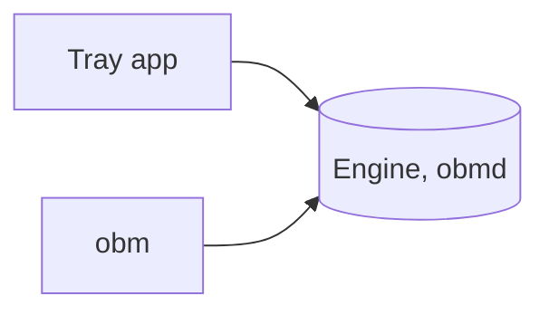

# Getting started

Open Backup Manager backs up your folders and keeps them in sync with the cloud. This page gets it installed and shows where things are.

## Install it

=== "Windows"

    1. Download `OpenBackupManager.App-win-x64-Setup.exe` from the [releases on GitHub](https://github.com/AmyJeanes/OpenBackupManager/releases), or `OpenBackupManager.App-win-arm64-Setup.exe` for an Arm PC.
    2. Run it. There's nothing to choose: it installs for you only, and doesn't need administrator rights.
    3. The app starts in the tray, by the clock, and starts again each time you sign in.

    !!! tip "Check it first"

        You can check a download came from the project's build unchanged before you run it. See [Checking a download](checking-downloads.md).

=== "macOS"

    There's nothing to download for macOS yet, and the app comes later. The command line, `obm`, and its engine, `obmd`, already run on macOS, but for now you build them from source, as [CONTRIBUTING.md](https://github.com/AmyJeanes/OpenBackupManager/blob/main/CONTRIBUTING.md#build-and-test) describes.

=== "Linux"

    There's nothing to download for Linux yet, and the app comes later. The command line, `obm`, and its engine, `obmd`, already run on Linux, but for now you build them from source, as [CONTRIBUTING.md](https://github.com/AmyJeanes/OpenBackupManager/blob/main/CONTRIBUTING.md#build-and-test) describes.

## Where your settings are

=== "Windows"

    ```
    %LocalAppData%\OpenBackupManager\config.toml
    ```

    Changes apply as soon as you save. See [Settings](settings.md) for each setting.

=== "macOS"

    There are no settings on macOS yet: the ones there are so far are all for the app.

=== "Linux"

    There are no settings on Linux yet: the ones there are so far are all for the app.

## How it fits together



The engine does the work in the background, and `obm`, the command line, talks to it to show what it's doing.

=== "Windows"

    The tray app talks to the engine too. It starts the engine for you, and when you quit, it stops the engine if it was the one that started it.

=== "macOS"

    There's no tray app yet, so you start the engine yourself. See [The engine](command-line.md#the-engine).

=== "Linux"

    There's no tray app yet, so you start the engine yourself. See [The engine](command-line.md#the-engine).

??? question "Do I need to run it as administrator?"

    No. It backs up your own folders, so run it as yourself. See [Running as administrator or root](command-line.md#running-as-administrator-or-root).

