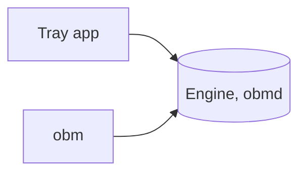

# Getting started

Open Backup Manager backs up your folders and keeps them in sync with the cloud. This page gets it installed and shows where things are.

## Install it

=== "Windows"

    1. Download `OpenBackupManager.App-win-x64-Setup.exe` from the [releases on GitHub](https://github.com/AmyJeanes/OpenBackupManager/releases), or `OpenBackupManager.App-win-arm64-Setup.exe` for an Arm PC.
    2. Run it. There's nothing to choose: it installs for you only, and doesn't need administrator rights.
    3. The app starts in the tray, by the clock, and starts again each time you sign in.

    !!! tip "Check it first"

        You can check a download came from the project's build unchanged before you run it. See [Checking a download](checking-downloads.md).

=== "macOS"

    There's no app for macOS yet, but the command line, `obm`, and its engine, `obmd`, are ready to download.

    1. Download `OpenBackupManager-<version>-osx-arm64.tar.gz` from the [releases on GitHub](https://github.com/AmyJeanes/OpenBackupManager/releases), or `OpenBackupManager-<version>-osx-x64.tar.gz` for an Intel Mac.
    2. Unpack them into a folder on your PATH, such as `~/.local/bin`:

        ```
        mkdir -p ~/.local/bin
        tar -xzf ~/Downloads/OpenBackupManager-<version>-osx-arm64.tar.gz -C ~/.local/bin obm obmd
        ```

        On an Intel Mac, unpack `OpenBackupManager-<version>-osx-x64.tar.gz` instead. If macOS asks whether Terminal can access your Downloads folder, allow it. If `obm --version` isn't found after that, add `export PATH="$HOME/.local/bin:$PATH"` to `~/.zshrc` and open a new terminal.

    3. Start the engine with `obm service install`, which keeps it running from when you sign in, or with `obmd` in a terminal. See [The engine](command-line.md#the-engine).

    !!! warning "If macOS won't open them"

        A browser marks what it downloads as quarantined, and macOS won't run a quarantined program that isn't signed by Apple, which these aren't yet. If it says "“obm” Not Opened", as Apple could not verify it's free of malware, remove the quarantine:

        ```
        xattr -d com.apple.quarantine ~/.local/bin/obm ~/.local/bin/obmd
        ```

        Downloading with `curl` instead leaves nothing to remove:

        ```
        curl -L -o ~/Downloads/OpenBackupManager-<version>-osx-arm64.tar.gz https://github.com/AmyJeanes/OpenBackupManager/releases/download/v<version>/OpenBackupManager-<version>-osx-arm64.tar.gz
        ```

        On an Intel Mac, use `osx-x64` in both places.

    !!! tip "Check it first"

        You can check a download came from the project's build unchanged before you run it. See [Checking a download](checking-downloads.md).

=== "Linux"

    There's no app for Linux yet, but the command line, `obm`, and its engine, `obmd`, are ready to download.

    1. Download `OpenBackupManager-<version>-linux-x64.tar.gz` from the [releases on GitHub](https://github.com/AmyJeanes/OpenBackupManager/releases), or `OpenBackupManager-<version>-linux-arm64.tar.gz` for an Arm computer, such as a Raspberry Pi with a 64-bit system.
    2. Unpack them into a folder on your PATH, such as `~/.local/bin`:

        ```
        mkdir -p ~/.local/bin
        tar -xzf ~/Downloads/OpenBackupManager-<version>-linux-x64.tar.gz -C ~/.local/bin obm obmd
        ```

        On an Arm computer, unpack `OpenBackupManager-<version>-linux-arm64.tar.gz` instead. If `obm --version` isn't found after that, add `export PATH="$HOME/.local/bin:$PATH"` to `~/.bashrc` and open a new terminal.

    3. Start the engine with `obm service install`, which keeps it running from when you sign in, or with `obmd` in a terminal. See [The engine](command-line.md#the-engine).

    They need ICU, a library for text in every language, which desktop distros already have. On a minimal or server install, add it with your package manager, such as `sudo apt install libicu72` on Debian 12 or `sudo dnf install libicu` on Fedora and RHEL. Each build is checked on Debian 12 and RHEL 9, and should run on anything newer.

    !!! tip "Check it first"

        You can check a download came from the project's build unchanged before you run it. See [Checking a download](checking-downloads.md).

## Where your settings are

=== "Windows"

    ```
    %LocalAppData%\OpenBackupManager\config.toml
    ```

    Changes apply as soon as you save. See [Settings](settings.md) for each setting.

=== "macOS"

    There are no settings on macOS yet: the ones there are so far are all for the app.

=== "Linux"

    There are no settings on Linux yet: the ones there are so far are all for the app.

## How it fits together



The engine does the work in the background, and `obm`, the command line, talks to it to show what it's doing.

=== "Windows"

    The tray app talks to the engine too. It starts the engine for you, and when you quit, it stops the engine if it was the one that started it.

=== "macOS"

    There's no tray app yet, so you start the engine yourself, or have `obm service install` keep it running. See [The engine](command-line.md#the-engine).

=== "Linux"

    There's no tray app yet, so you start the engine yourself, or have `obm service install` keep it running. See [The engine](command-line.md#the-engine).

??? question "Do I need to run it as administrator?"

    No. It backs up your own folders, so run it as yourself. See [Running as administrator or root](command-line.md#running-as-administrator-or-root).

